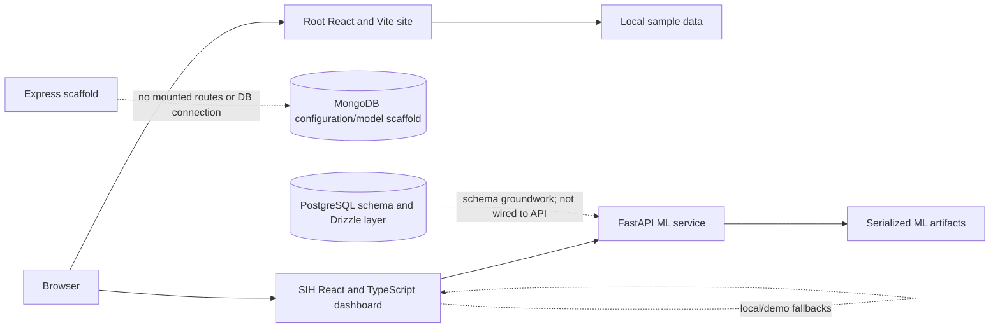
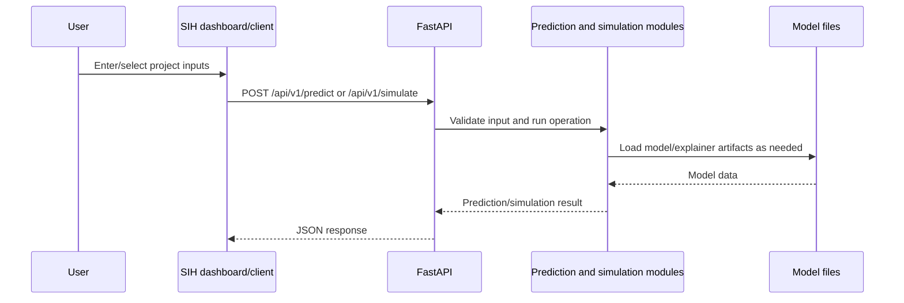
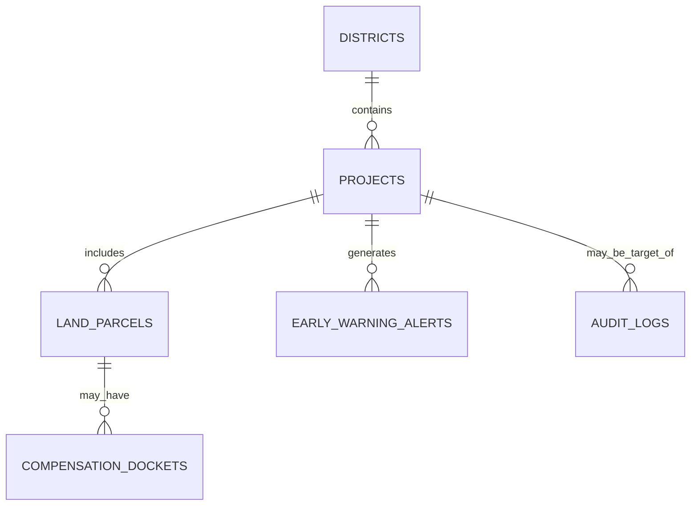

# Land Information Governance Platform (BhoomiSetu)

BhoomiSetu is a project workspace containing a public land-information browsing prototype, a small Express backend scaffold, and a separate SIH 2026 land-acquisition decision-support prototype. The repository contains demonstration data and experimental components; it is not a connected or authoritative land-record service.

> **Data notice:** Land statistics, catalog entries, sample projects, model inputs and fallback API responses are demonstration or sample data. The software does not independently verify land ownership or government records. Confirm land and policy information with the relevant official sources.

## Contents

- [Overview](#1-project-overview)
- [Problem and objectives](#2-problem-statement-and-3-project-objectives)
- [Features and implementation status](#4-key-features-and-5-implemented-vs-planned-features)
- [Technology stack](#6-technology-stack)
- [Architecture](#7-system-architecture)
- [Repository structure](#8-project-folder-structure)
- [Installation and setup](#9-installation-and-setup)
- [Configuration](#10-environment-variables-and-configuration)
- [Workflows](#11-application-workflow)
- [Data model](#12-database-design-and-relationships)
- [API](#13-api-documentation)
- [Screenshots](#14-application-screenshots)
- [Future work](#15-future-improvements)
- [Contributing](#16-contributing-guidelines)
- [License](#17-license)

## 1. Project Overview

The repository currently has two user-facing prototypes:

1. **Root application** — a React 19 and Vite site for browsing regional land-use summaries, sample research entries and sample policy references. Its screens use local JavaScript data; the site does not call the Express scaffold.
2. **SIH 2026 prototype** — `sih-copy2026/Bhoomi_Setu_Land_Acquisition_SIH_2026`, a React/TypeScript dashboard concept for land-acquisition project monitoring, paired with a Python FastAPI prediction and simulation service. It also includes ML artifacts, CSV data, and PostgreSQL/Drizzle schema definitions. Several dashboard API paths are client-side integration targets with local fallback data; they are not implemented by the included FastAPI service.

The root application is the default entry point for this repository (`npm run dev`). The SIH prototype has its own package and setup instructions. Treat both as prototypes when evaluating features and data.

## 2. Problem Statement

Land information, research and policy references may be spread across different sources and formats. This project explores a more accessible way to browse land-use summaries alongside related reading and policy context. The separate SIH prototype explores monitoring land acquisition milestones and presenting model-generated delay-risk signals to support review. It does not make legal determinations or verify ownership.

## 3. Project Objectives

- Provide a simple way to explore sample land classification and ownership summaries by state and selected districts.
- Present sample research and policy listings with search and filters.
- Demonstrate a separate project-monitoring dashboard and delay-risk prediction workflow.
- Make the prototype’s sample-data and integration boundaries visible so users can distinguish demonstration content from connected official sources.

## 4. Key Features

### Root application

- Home, About, Explore, Research and Policies pages.
- State and district selection, land classification charts, and government/private share visualizations using local demonstration data.
- Search and category filters for a sample research catalogue.
- Search, jurisdiction and category filters for a sample policy directory.
- Login and sign-up screens for public, researcher and government roles. In this prototype, public sign-up stores a demo account in browser `localStorage`; non-public registration displays a verification-required state. This is not production authentication.

### SIH 2026 prototype

- Dashboard views for project overview, ML models, corridor map, district diagnostics, early warnings, fund tracking, group land, project details, intelligence, policy briefing, state benchmarking, settings and audit log.
- Python FastAPI endpoints for model health/metadata, delay prediction and what-if simulation.
- A client-side prediction engine and fallback responses in `src/lib/api.ts` for offline/demo behavior.
- SQL/Drizzle schemas describing projects, parcels, districts and early-warning records.

These SIH screens and data structures are part of a prototype. Their presence does not mean that every view is backed by persistent data or a working API.

## 5. Implemented vs Planned Features

| Capability | Status in this repository | Notes |
|---|---|---|
| Root land explorer | Implemented as a frontend demo | Uses hard-coded sample values in `frontend/src/data/mockData.js`. |
| Research and policy browsing | Implemented as frontend demos | Sample records, not connected to external catalogues or official documents. |
| Root login/sign-up experience | Partially implemented demo | Public demo account uses local storage; no credential verification service is connected. |
| Express/MongoDB API | Scaffold only | Server starts and configures CORS/JSON parsing. Route/controller/model files are empty exports; no API routes or database connection are mounted. |
| SIH dashboard | Prototype screens implemented | Dashboard has local/demo fallbacks and integration calls. |
| SIH ML API | Implemented in source | FastAPI exposes health, model metadata, prediction and simulation routes. Actual model operation depends on Python packages and model artifacts. |
| SQL persistence | Schema/integration groundwork | SQL DDL and Drizzle schema exist; database initialization is not integrated into the root app or FastAPI routes. |
| Verified official land records and ownership | Not implemented | No verified government data integration is present. |
| SIH dashboard CRUD/auth/project endpoints | Not implemented by included FastAPI service | The frontend client references these paths, but `ml/main_fastapi.py` does not define them. |

## 6. Technology Stack

| Area | Technologies found | Use |
|---|---|---|
| Root UI | React 19, React DOM, React Router 7 | Page rendering and routing. |
| Root build tooling | Vite 8, `@vitejs/plugin-react`, Oxlint, Prettier | Development/build, lint and formatting scripts. |
| Root backend scaffold | Node.js, Express 5, CORS, dotenv | Minimal HTTP server setup. |
| Declared root backend data/auth dependencies | Mongoose 8, bcrypt 6 | Listed dependencies; no active DB connection or auth routes are wired. |
| SIH UI | React 19, TypeScript 5.9, Vite 7, Wouter | Dashboard UI and client-side routing. |
| SIH UI libraries | Tailwind CSS 4, Radix UI packages, TanStack Query, Recharts, Framer Motion, Lucide React | Styling, UI primitives, data display and motion. |
| SIH API and ML | Python, FastAPI, Uvicorn, Pydantic, scikit-learn, XGBoost, SHAP, pandas, NumPy, joblib | Model inference and what-if simulation code. Python dependencies are listed in the SIH `ml/requirements.txt` and `requirements.txt`. |
| SIH data layer definitions | PostgreSQL (`pg`), Drizzle ORM/Kit | SQL pool and schema definitions; do not assume a configured/live database. |
| Additional listed SIH dependencies | Firebase client/admin SDK | Present in `package.json`; actual auth/data use should be reviewed before deployment. |

Versions above reflect the checked-in package manifests, which use semver ranges. Use the corresponding lockfile when installing dependencies.

## 7. System Architecture

### Repository components



The root UI and Express process are independently runnable; there is no root frontend-to-backend API integration in the checked-in source. The SIH API client uses `VITE_API_URL` or `/api/v1` and can fall back to local/demo behavior for some calls. FastAPI loads the prediction artifacts when required. The defined Drizzle pool is not used by the FastAPI service.

### SIH prediction request flow



## 8. Project Folder Structure

```text
.
├── package.json                         # Root convenience scripts; delegates to frontend
├── frontend/                             # Main public browsing prototype
│   └── src/
│       ├── components/                   # Navigation, footer and presentation components
│       ├── data/mockData.js               # Demonstration land/research/policy content
│       ├── pages/                         # Home, Explore, Research, Policies, About, Auth
│       ├── App.jsx                        # React Router definitions
│       └── main.jsx                       # Frontend entry point
├── backend/                               # Small Express/Mongoose scaffold
│   ├── config/db.js
│   ├── controllers/ routes/ models/        # Empty placeholder modules at present
│   └── server.js
├── backend-r/                              # Separate package manifest; no application source present
└── sih-copy2026/Bhoomi_Setu_Land_Acquisition_SIH_2026/
    ├── src/                                # SIH dashboard UI, views and API client
    ├── ml/                                 # FastAPI app, inference, training and simulation code
    ├── models/                             # Serialized artifacts, metadata and sample projects
    ├── database/                           # SQL schema, seed/query scripts and notes
    ├── api/index.py                        # Serverless import entry point for FastAPI
    ├── backend/server.py                   # Local FastAPI server entry point
    ├── src/db/                              # Drizzle schema and PostgreSQL pool
    ├── docs/                                # SIH setup, security and presentation documents
    ├── requirements.txt                    # Python dependencies for this prototype
    └── package.json                        # SIH frontend scripts and dependencies
```

## 9. Installation and Setup

### Main application (repository root)

Prerequisites: Node.js and npm. Install the frontend package from the repository root, then run the root convenience script:

```bash
cd frontend
npm install
cd ..
npm run dev
```

Vite serves the frontend on its default local development address (normally `http://localhost:5173`). The root script delegates to `frontend`. The root package provides these additional scripts:

```bash
npm run build
npm run lint
npm run preview
npm run format
```

Alternatively, run `npm run dev` from inside `frontend` after installation. The root package has no dependencies of its own; its scripts delegate to the frontend package.

### Root Express scaffold (optional)

In a second terminal:

```bash
cd backend
npm install
npm run dev
```

The process listens on port `5000` by default. It currently exposes no application API routes and does not connect to MongoDB. The root UI does not depend on this server.

### SIH 2026 dashboard and ML API (optional, separate prototype)

Install the dashboard dependencies and start its Vite server:

```bash
cd sih-copy2026/Bhoomi_Setu_Land_Acquisition_SIH_2026
npm install
npm run dev
```

The package runs Vite on port `3000`. For the FastAPI service, create and activate a Python virtual environment, then install the SIH ML requirements:

```bash
python3 -m venv .venv
source .venv/bin/activate
pip install -r ml/requirements.txt
uvicorn ml.main_fastapi:app --host 0.0.0.0 --port 8000 --reload
```

The API documentation is available at `http://localhost:8000/docs`. Prediction depends on available compatible files under `models/`. `npm run typecheck` is available in the SIH package; `npm run lint` runs the same TypeScript check. The root and SIH package scripts are separate and should be run from their respective directories.

## 10. Environment Variables and Configuration

No checked-in environment file is required by the root frontend. Do not commit secrets. Only variables found by inspecting source are listed here:

| Variable | Component | Purpose | Default/notes |
|---|---|---|---|
| `PORT` | Root Express scaffold | HTTP port | `5000` when unset. |
| `FRONTEND_ORIGIN` | Root Express scaffold | CORS allowed origin | `http://localhost:5173` when unset. |
| `VITE_API_URL` | SIH frontend | Base URL for the API client | If unset, client uses `/api/v1`; can be set to an API host/base URL. |
| `BASE_PATH` | SIH Vite config | Vite base path | `/` when unset. |
| `PORT` | SIH Vite config | Development server port | `3000` when unset. |
| `SQL_HOST`, `SQL_USER`, `SQL_PASSWORD`, `SQL_DB_NAME` | SIH Drizzle pool | PostgreSQL connection settings | Required to connect the pool; no live connection is guaranteed. |
| `SQL_ADMIN_USER`, `SQL_ADMIN_PASSWORD` | SIH Drizzle config | Drizzle configuration credentials | Referenced by `src/db/drizzle.config.ts`. |

The root Express process imports dotenv and reads `PORT` and `FRONTEND_ORIGIN`. It does not use a MongoDB URI. Mongoose is declared as a dependency, but the checked-in DB module is empty. No MongoDB environment variable can be documented as implemented.

## 11. Application Workflow

### Root browsing prototype

1. Open the home page and navigate to Explore, Research, Policies or About.
2. On Explore, select a state and, where demonstration figures exist, a district. Charts update from local data.
3. Search/filter sample research and policy entries. Detail dialogs show the local record and a notice where source documents are not attached.
4. Login/sign-up paths are a UI demonstration. Public demo signup stores a browser-local record. No account is sent to a backend.

### SIH 2026 prototype

1. Start its Vite UI and separately start the FastAPI service if using remote inference.
2. Dashboard components call functions in `src/lib/api.ts`; the client builds its API base from `VITE_API_URL` or `/api/v1`.
3. Prediction requests are sent to the FastAPI `/api/v1/predict` endpoint. The client also contains embedded local prediction/fallback behavior.
4. What-if requests can be sent to `/api/v1/simulate`; the client has local fallback calculations as well.

Other client functions reference project, dashboard, group-land and map routes that are not defined by the included FastAPI service. Those workflows require backend implementation to provide persistent/remote behavior.

## 12. Database Design and Relationships

### Root backend

The root backend includes a `User.js` model path and `config/db.js`, but both files are currently empty module exports. No MongoDB schema, connection, collections or relationships are implemented. Authentication logic in the root frontend is local-demo behavior.

### SIH relational schema

`src/db/schema.ts` defines Drizzle/PostgreSQL tables for `users`, `districts`, `projects`, `land_parcels` and `early_warning_alerts`. The separate `database/schema.sql` also describes compensation dockets and audit logs. These definitions are groundwork; they are not evidence of a populated production database or connected data service.

| Entity | Purpose | Relationships in Drizzle schema |
|---|---|---|
| `users` | User identity fields including Firebase UID, email, name and role | No relation declared in this schema. |
| `districts` | District/state summary and monitoring metrics | One district can be related to many projects. |
| `projects` | Project, jurisdiction, acquisition, compensation and risk fields | Optional district; one project to many parcels and alerts. |
| `land_parcels` | Parcel identifiers, location, area, classification and possession fields | Each parcel references one project. |
| `early_warning_alerts` | Risk cause, recommended action, status and deadline | Each alert references one project. |
| `compensation_dockets`* | SQL DDL fields for parcel-linked compensation/DBT record | References a parcel in `database/schema.sql`; absent from the Drizzle schema. |
| `audit_logs`* | SQL DDL fields for action history | Present in SQL DDL only; no Drizzle relation defined. |

`*` Defined in the standalone SQL file, not in `src/db/schema.ts`.



The SQL diagram includes the extra SQL-only tables. `AUDIT_LOGS` uses generic target entity/ID columns rather than an enforced foreign key to projects. Schema declarations do not establish that writes, migrations, or database-backed workflows are active.

## 13. API Documentation

### Express backend

There are no registered Express routes in `backend/server.js`; `backend/routes/authRoutes.js` and related controller/model files contain only empty exports. Therefore, the root backend currently has **no application API endpoints**.

### SIH FastAPI service

Source: `sih-copy2026/Bhoomi_Setu_Land_Acquisition_SIH_2026/ml/main_fastapi.py`. JSON bodies use Pydantic models. FastAPI interactive documentation is at `/docs` when the service is running.

| Method | Path | Request | Purpose |
|---|---|---|---|
| `GET` | `/health/ready` | None | Health/artifact readiness status. |
| `GET` | `/api/v1/health` | None | Same health handler as `/health/ready`. |
| `GET` | `/api/v1/model-metadata` | None | Returns `models/model_metadata.json` if present; otherwise returns a metadata fallback. |
| `POST` | `/api/v1/predict` | `ProjectInputSchema` JSON | Runs model delay-risk prediction. |
| `POST` | `/api/v1/simulate` | `WhatIfSchema` JSON | Runs counterfactual simulation for a project and modifications. |

#### Prediction request fields

The fields below are optional in the schema and have illustrative defaults. `extra="allow"` means additional input keys are accepted by Pydantic, but that does not guarantee the model uses them.

| Field | Type | Field | Type |
|---|---|---|---|
| `project_id` | string | `state` | string |
| `district` | string | `project_type` | string |
| `acquisition_stage` | string | `project_cost` | number |
| `project_length_km` | number | `land_required_hectares` | number |
| `land_acquired_pct` | number | `land_pending_pct` | number |
| `private_land_pct` | number | `government_land_pct` | number |
| `forest_land_pct` | number | `affected_families` | number |
| `affected_landowners` | number | `vulnerable_households` | number |
| `compensation_awarded_amount` | number | `compensation_paid_amount` | number |
| `compensation_pending_amount` | number | `compensation_pending_pct` | number |
| `court_case_count` | number | `legal_case_count` | number |
| `arbitration_case_count` | number | `ownership_dispute_count` | number |
| `possession_pct` | number | `row_available_pct` | number |
| `encumbrance_free_pct` | number | `public_objection_count` | number |
| `unresolved_grievances` | number | `days_in_current_stage` | number |
| `days_since_notification` | number |  |  |

Example request:

```json
{
  "project_id": "PRJ_DEMO_01",
  "state": "Gujarat",
  "district": "Gujarat_Dist_04",
  "project_type": "Highway",
  "acquisition_stage": "Compensation Disbursement",
  "project_cost": 500.0,
  "land_required_hectares": 120.0,
  "land_acquired_pct": 35.0,
  "compensation_pending_pct": 58.3,
  "court_case_count": 5
}
```

For simulation, send `{"project": { ...ProjectInputSchema fields... }, "modifications": {"compensation_pending_pct": 15, "court_case_count": 1, "possession_pct": 70}}`. `modifications` is a JSON object of values applied to a counterfactual project input.

The FastAPI route handlers return JSON from the ML functions or an HTTP 500 error with a `detail` on failure. Exact result fields are generated by `ml/predict.py` and `ml/what_if.py` and depend on model execution. Do not interpret the model output as a legal conclusion or independently verified status.

#### Client routes without a matching FastAPI endpoint

`src/lib/api.ts` also references routes such as `/auth/login`, `/dashboard/overview`, `/projects`, `/projects/{id}`, `/projects/{id}/timeline`, `/projects/{id}/predict`, `/projects/{id}/simulate`, `/projects/{id}/recommendations`, `/group-land/*` and `/map/*`. These are not registered in the included `ml/main_fastapi.py`. Some client methods use demo fallback objects; they should not be described as working remote API functionality.

## 14. Application Screenshots

No checked-in application screenshots were identified. Add screenshots here when captured from the running prototype, and label any demo data shown. Suggested placeholders:

| Screen | Screenshot |
|---|---|
| Root Explore page | `<!-- Add screenshot: docs/screenshots/explore.png -->` |
| SIH dashboard | `<!-- Add screenshot: docs/screenshots/sih-dashboard.png -->` |

## 15. Future Improvements

- Connect approved official land data sources and cite source, date and jurisdiction on each dataset.
- Replace demonstration data with maintained, validated data and add clear provenance.
- Implement and secure actual authentication, authorization and user verification.
- Decide on one backend/data architecture and connect the UI to documented, tested endpoints.
- Complete the dashboard endpoints used by the SIH UI and persist data through the relational schema if that architecture is retained.
- Add request validation, error handling, access controls, audit behavior and operational configuration appropriate to deployment.
- Add test coverage, migrations and reproducible model evaluation before relying on prediction outputs.
- Provide accessible screenshots and versioned API documentation.

## 16. Contributing Guidelines

1. Create a focused branch and describe the change and its scope.
2. Keep root-app and SIH-prototype changes clearly separated because they have different package files and workflows.
3. Mark synthetic, sample or fallback data clearly; do not present it as official or verified.
4. Document any new environment variables and API routes from the implementation, without committing credentials.
5. Run the relevant package scripts from the correct directory and include the commands and results in the change description.
6. Avoid including personal, confidential or real landowner information in examples, screenshots or fixtures.

## 17. License

No license file or license declaration was found in the repository root. The project’s reuse and distribution terms are therefore unspecified.
